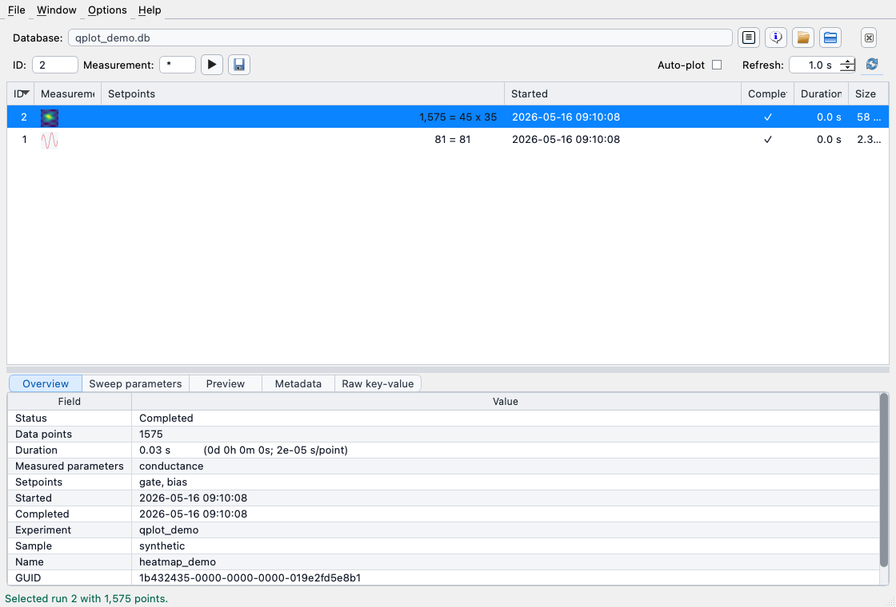
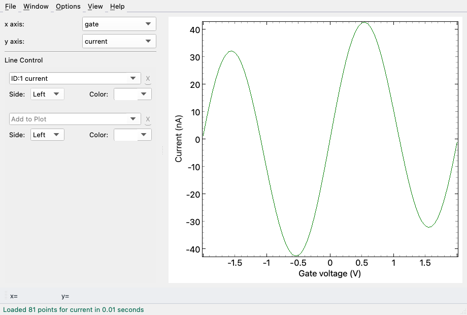
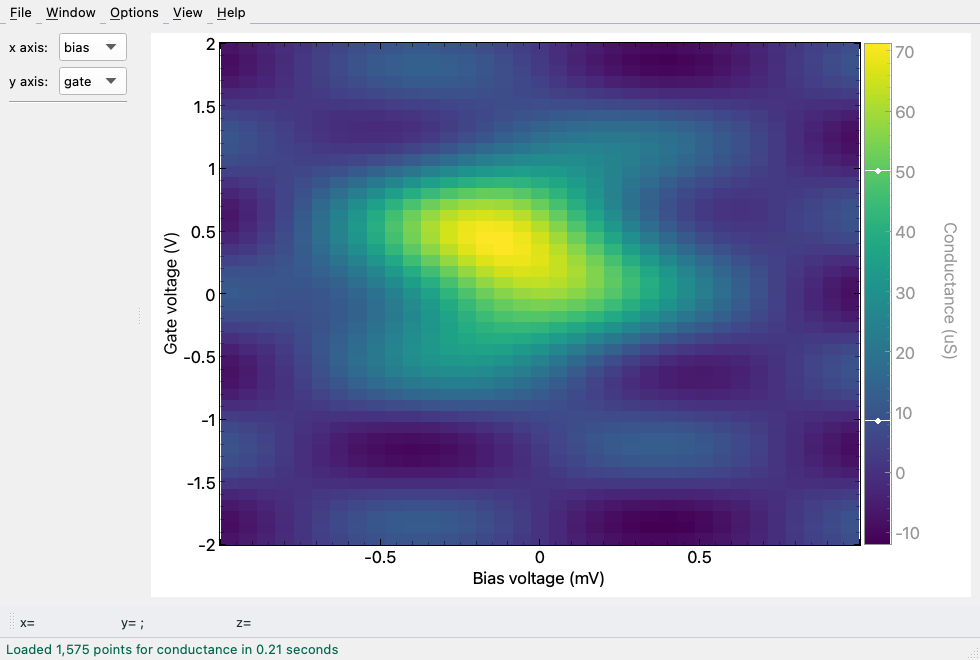
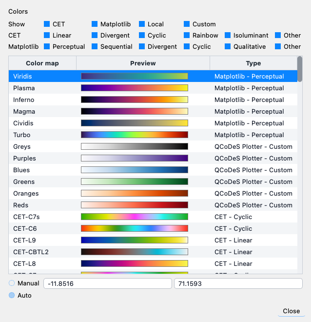

# Demo Data

qPlot does not keep generated QCoDeS databases in the repository. For demos,
screenshots, and manual live-refresh checks, use the local helper scripts from
the repository root.

## Generate a Test Database

In qPlot, use `File -> Generate Test Data -> Create Example CSV...` to choose
where to save a ready-to-use specification. qPlot creates the file, reveals it
in Finder on macOS, or opens its containing folder in the platform file manager.
Edit the CSV in a spreadsheet application, then use
`File -> Generate Test Data -> Generate Database from CSV...` to choose the CSV
and its output `.db` file. Generation runs in the background so qPlot remains
responsive.

For performance and scaling tests, use
`File -> Generate Test Data -> Export CSV Collection...`. The ten installed
instruction files form a cumulative series: every file contains all the runs
from its predecessor, followed by three larger 2D runs. Each file starts with
five 1D traces (current, conductance, resistance, transconductance, and current
again) with the same `V_SD` range and sampling, so trace addition, removal,
reordering, and secondary axes can be tested even with the smallest database.
Every file also includes a `mixed_dimensions` run containing 1D, 2D, 3D, and 4D
quantities with shared setpoint axes. More than 90% of the samples remain in
1D and 2D quantities. Higher-dimensional quantities show `3D`, `4D`, etc.
placeholders; their context menus offer CSV export and statistics.
The nominal database sizes and largest grids are:

| File | Approximate database size | Largest 2D run |
| --- | ---: | ---: |
| `qplot_test_db_01_10mb.csv` | 10 MB | 201 x 301 |
| `qplot_test_db_02_25mb.csv` | 25 MB | 301 x 451 |
| `qplot_test_db_03_50mb.csv` | 50 MB | 401 x 601 |
| `qplot_test_db_04_100mb.csv` | 100 MB | 551 x 851 |
| `qplot_test_db_05_250mb.csv` | 250 MB | 1001 x 1501 |
| `qplot_test_db_06_500mb.csv` | 500 MB | 1251 x 1901 |
| `qplot_test_db_07_1gb.csv` | 1 GB | 1801 x 2701 |
| `qplot_test_db_08_5gb.csv` | 5 GB | 5001 x 7501 |
| `qplot_test_db_09_10gb.csv` | 10 GB | 5601 x 8401 |
| `qplot_test_db_10_30gb.csv` | 30 GB | 11001 x 17001 |

Sizes are estimates calibrated against QCoDeS SQLite output and will vary with
QCoDeS and SQLite versions. Large databases can take a long time to generate.
Ensure the destination has comfortably more free space than the nominal size;
overwriting an existing database temporarily requires space for both files.

The installed `qplot-generate-db` command provides the same workflow from a
terminal. Start by writing an example CSV:

```console
qplot-generate-db --write-example test-runs.csv
```

Export the complete installed collection with:

```console
qplot-generate-db --write-collection test-db-csv-series
```

Edit the CSV in a spreadsheet application, then generate the database:

```console
qplot-generate-db test-runs.csv test-runs.db
```

During generation, qPlot prints timestamped start and stop messages for the
database and each run, including elapsed times and whether generation completed,
was cancelled, or failed. These appear alongside QCoDeS's existing
`Starting experimental run with id:` messages.

Generation requires QCoDeS's `dataset.raw_data_backend` to be `sqlite_main_db`,
`dataset.export_automatic` to be false, and
`subscription.default_subscribers` to be empty. Other settings are rejected
before creating files because they can write outside the selected output.
qPlot leaves these global settings unchanged and uses an empty private station
so synthetic measurements do not read parameters from an acquisition station.

The CSV has these columns:

```csv
run,kind,name,label,unit,setpoints,start,stop,points
mixed,axis,bias,Bias,V,,-0.1,0.1,101
mixed,axis,gate,Gate,V,,-1,1,11
mixed,axis,field,Magnetic field,T,,0,1,3
mixed,measurement,current,Current,nA,bias,,,
mixed,measurement,conductance,Conductance,uS,gate;bias,,,
mixed,measurement,signal,Signal,a.u.,field;gate;bias,,,
```

Rows with the same `run` value belong to one QCoDeS run with that name. Runs
and measured quantities retain their first-declaration order. An `axis` row
declares a shared independent parameter, with finite, different endpoints and
at least two points. Its `setpoints` cell must be blank. A `measurement` row
lists its axes in `setpoints`, separated by semicolons, ordered from outermost
(slowest) to innermost (fastest). Its `start`, `stop`, and `points` cells must
be blank. Units may be blank; names and labels are required.

Add as many axis rows and setpoint names as needed for higher dimensionality.
Axis declarations may appear before or after their measurements. Names must
be unique within a run, including across axes and measurements; each setpoint
must refer to an axis declared in that run, and each declared axis must be used.
Multiple quantities may share all or some axes, or use separate axes. A shared
axis always has one definition. Each quantity records its own Cartesian grid
once, with a sample count equal to the product of its axis point counts;
lower-dimensional quantities are not repeated over extra axes of other
quantities. QCoDeS stores unrelated quantities as NULL in those result rows.
The total reported point count is the sum across measured quantities.

Each signal is the sum of two sinusoids with independently randomised
amplitudes, phases, and frequencies along every axis. Generation writes bounded
chunks without constructing a full multidimensional grid in memory. The old
CSV format is no longer accepted; export a new example or collection template.

Existing CSV or database files are not replaced unless
`--overwrite` is supplied. Collection export also refuses to replace existing
collection files without `--overwrite`. Even with `--overwrite`, database
generation refuses publication if the destination changed while generation was
running or if a `-wal`, `-shm`, or `-journal` sidecar is present. Close the
application using that database, or choose another output path; qPlot never
removes or modifies those destination sidecars. Every generated test database
carries a unique internal generation token and a bounded parent-linked nonce
chain. Later writes to covered tables extend that chain, allowing a fresh qPlot
process to prove that a WAL descends from the exact published main and show its
committed values. A QCoDeS script that creates later measurements must first
call `qplot.testdata.enable_generation_provenance_for_writer` on a quiescent
writable connection, before creating the experiment or measurement; this
persists coverage for each new result table before its creation transaction
commits. A nonempty pre-existing WAL, divergent branch, missing chain, or
exhausted proof window is refused with owner-checkpoint instructions instead of
being silently trusted. If
a sidecar is detected before the atomic swap completes, qPlot restores the old
main and retains an explicit
`.qplot-publishing` safety guard until the owning SQLite application has
resolved the sidecars.

When the GUI replaces an online-only cloud file, it first downloads the existing
destination through qPlot's cancellable, read-only cloud-prefetch helper. The
status bar shows sync progress, using the same cloud timeout as database loading.
The generator checks that the destination is readable before generating the new
data, and repeats the safety checks immediately before publication. A download
or read timeout is reported as an access failure, with the original error and
recovery instructions. If the provider cannot supply the old file, make it
available offline or select a new output filename. Error dialogs can be resized
and their complete text copied with **Copy**.

Run `qplot-generate-db --help` for the complete command reference.

## Screenshots

The committed screenshots below are generated from a small synthetic database.









## Regenerate Screenshots

Run:

```console
python scripts/capture_demo_screenshots.py
```

The script creates a temporary synthetic database under the system temp
directory by default, starts qPlot offscreen, and overwrites the PNG files in
`docs/assets`. Set `QPLOT_DEMO_WORKDIR` to choose a different working folder,
or `QPLOT_DEMO_ASSET_DIR` to write screenshots somewhere other than
`docs/assets`.

Each run uses a fresh private database directory inside the working folder and
removes it after the plots close. Existing databases and their sidecars in the
working folder are preserved.

## Generate Synthetic Data

Run:

```console
python scripts/liveplot.py
```

The script creates a new database at:

```text
tests/data/qplot-demo.db
```

That database is ignored by Git. The script refuses to run if the database or
any of its WAL, SHM or rollback-journal files already exists. Use a fresh working
directory when generating another database for screenshots or manual testing.
From that directory, run the script using its absolute repository path instead
of the relative command above.

## Manual Demo Flow

1. Start qPlot with `python scripts/manual_run.py`.
2. Load `tests/data/qplot-demo.db`.
3. Select a run with both line and heatmap parameters.
4. Capture any additional workflow-specific views that are not covered by
   `scripts/capture_demo_screenshots.py`.

Keep screenshots focused on the actual application state. Avoid capturing local
paths, personal configuration values, or unrelated desktop windows.

## Refresh Testing

For local performance and live-refresh checks, use:

```console
python scripts/time_stress.py
```

The script creates a new timing CSV for each plot in the configured qPlot
directory, usually `~/.qplot`, and prints its path. Later timing rows use that
plot's file; the diagnostics remain after the plot closes. Existing files are
preserved. Those files are local diagnostics, not source assets.
